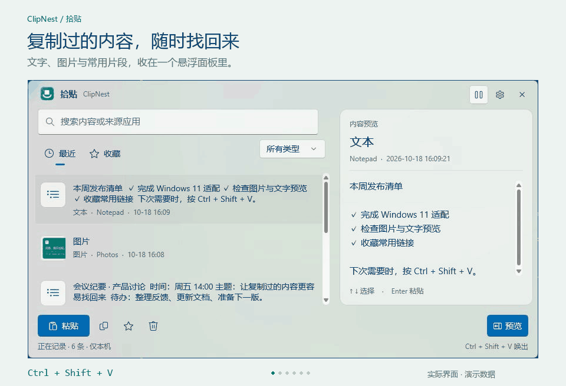
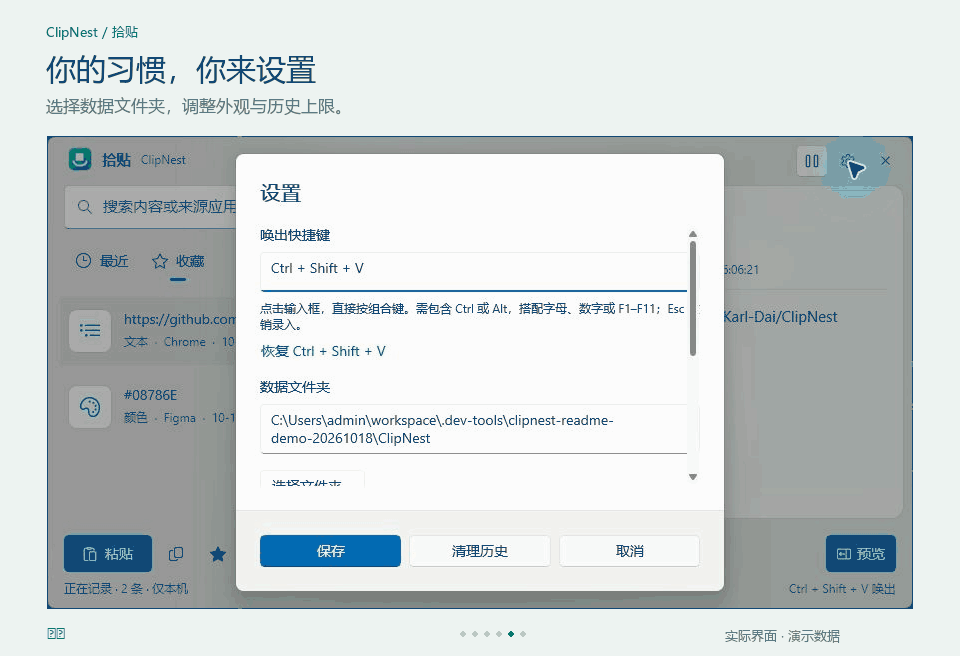

<div align="center">


# 拾贴 ClipNest

**复制过的内容，随时找回来。**

面向 Windows 11 的本地剪贴板管理器。用一个悬浮面板，收好文字、图片和常用片段。

[](#下载与安装)
[](#开发与构建)
[](https://github.com/Karl-Dai/ClipNest/releases/latest)
[](https://github.com/Karl-Dai/ClipNest/actions/workflows/build-windows.yml)

[**下载 Windows 版**](https://github.com/Karl-Dai/ClipNest/releases/latest) · [功能演示](#功能演示) · [使用指南](#使用指南) · [反馈问题](https://github.com/Karl-Dai/ClipNest/issues)

</div>

## 为什么做拾贴

刚复制的链接被下一次复制覆盖，截图要先粘贴才能确认，常用回复总要重新找——这些小事不应该打断工作。

拾贴在本机记录剪贴板历史。需要时按下 **Ctrl + Shift + V**，搜索或用方向键选中内容，预览确认后按 **Enter** 粘贴。用完收起，继续手头的事。

## 功能演示



*约 22 秒循环演示，录自 Windows 11 实际界面。画面中的记录均为专门生成的演示数据。*

| 功能 | 使用体验 |
| --- | --- |
| 悬浮面板 | 在鼠标附近唤出，顶部可拖动；不占任务栏或 Alt+Tab 列表 |
| 键盘浏览 | ↑ / ↓ 切换记录，右侧预览同步更新；Enter 粘贴 |
| 图片预览 | 列表显示缩略图，右侧完整缩放展示图片，并显示来源和时间 |
| 搜索与筛选 | 按内容或来源应用搜索；按文本、图片、文件、颜色、富文本筛选 |
| 常用收藏 | 保存常用链接、回复和片段；收藏不受普通历史上限影响 |
| 直接录入快捷键 | 点击输入框后按组合键，保存即生效；支持冲突提示和恢复默认 |
| 可选数据位置 | 选择空文件夹，自动迁移历史、收藏、图片与设置，并保留原目录备份 |
| 原生外观 | WinUI 3、Acrylic 背景、浅色 / 深色 / 跟随系统 |
| 托盘常驻 | 收起后继续记录；支持暂停记录和登录 Windows 时启动 |
| 安装与更新 | 桌面 / 开始菜单快捷方式；安装版自动检查并下载稳定版更新 |

### 支持的内容

| 类型 | 记录与预览 | 复制 / 粘贴 |
| --- | --- | --- |
| 文本、链接、代码片段 | 原文预览与搜索 | 文本 |
| 图片 | 列表缩略图及右侧预览 | 图片 |
| 文件与文件夹 | 路径列表 | 原文件与文件夹引用 |
| 颜色文本 | 识别并归类，如 `#08786E` | 颜色文本 |
| RTF 富文本 | 富文本预览 | 富文本及纯文本 |

文件记录保存的是路径引用，**不会备份文件本体**；原文件被移动或删除后无法从历史中恢复。图片记录会保存在独立的本地文件中。

## 下载与安装

**运行要求：Windows 11 22H2 或更高版本，x64。**

0.4.1 修复了长文本加载、历史分页与上限设置问题，验证范围见 [测试报告](docs/testing-0.4.1.md)。[下载 0.4.1](https://github.com/Karl-Dai/ClipNest/releases/tag/v0.4.1)，此版本暂未代码签名。

| 版本 | 发布页中的文件 | 适合谁 |
| --- | --- | --- |
| **安装版（推荐）** | `ClipNest-版本号-Setup-x64.exe` | 希望使用桌面快捷方式和自动更新 |
| 便携版 | `ClipNest-版本号-win-x64.zip` | 希望解压后运行、手动管理程序文件 |

**安装版：** 打开 [Releases](https://github.com/Karl-Dai/ClipNest/releases/latest)，下载 `Setup-x64.exe` 并运行。安装到当前用户目录 `%LOCALAPPDATA%\ClipNest.Windows`，自动创建“拾贴 ClipNest”桌面及开始菜单快捷方式，可从 Windows 已安装的应用中卸载。

**便携版：** 下载 ZIP，完整解压到固定文件夹，再运行其中的 `ClipNest/ClipNest.exe`。

便携包包含 .NET 与 Windows App SDK 运行时，无需另外安装。请保留程序同目录下的 DLL、资源和子文件夹；不要只取出 EXE 单独运行。

可使用发布页的 `.sha256` 文件校验下载：

```powershell
Get-FileHash .\ClipNest-0.4.1-Setup-x64.exe -Algorithm SHA256
```

### 更新版本

**安装版**启动约 15 秒后检查更新，之后每 6 小时自动检查一次。发现新稳定版后在后台下载并校验，下次启动自动应用；也可点击“重启更新”立即生效。设置中提供“检查更新”和自动检查开关，网络失败可稍后重试，不影响剪贴板使用。

**便携版**从托盘菜单退出后，解压新版并运行。便携版不会自动替换自身，也可运行安装包切换到安装版，默认历史仍从原数据目录读取。若启用了登录启动，移动便携版程序位置后请在设置中关闭再启用一次。

数据默认保存在程序文件夹之外。更新与卸载安装版会保留独立数据目录；请不要将数据放入程序安装文件夹。关闭自动检查后不再自动检查或下载，已经下载完成的更新仍会在下次启动时应用。

安装与更新由 [Velopack](https://docs.velopack.io/integrating/overview) 管理，更新源为本仓库的公开 GitHub Releases。发布页中的 `.nupkg`、`releases.win.json`、`RELEASES` 是更新组件需要的文件，普通用户下载安装程序即可。当前安装包未进行代码签名，可用发布页的 SHA256 校验文件核对下载。

## 使用指南

### 找到并粘贴历史内容

1. 在任何应用中正常复制内容。
2. 切回需要粘贴的位置，按 **Ctrl + Shift + V** 唤出拾贴。
3. 输入关键词搜索，或用 **↑ / ↓** 选择记录。
4. 查看右侧预览，按 **Enter** 或双击记录完成粘贴。

点击“复制”只会将选中的记录写入剪贴板，适合切换应用后手动粘贴。右下角“预览”可以收起或展开右侧面板。

| 操作 | 默认行为 |
| --- | --- |
| Ctrl + Shift + V | 唤出 / 收起历史面板，可在设置中修改 |
| ↑ / ↓ | 选择上一条 / 下一条，在搜索框中也可使用 |
| Enter / 双击记录 | 粘贴到唤出前的应用 |
| Esc / 点击外部 / 右上角关闭 | 收起面板，继续在托盘运行 |
| 星标按钮 | 收藏 / 取消收藏选中记录 |
| 右键托盘图标 → 退出 | 完全退出程序 |

设置等模态对话框打开时，请先完成或取消对话框，再收起面板。

### 直接按键设置快捷键



打开右上角 **设置**，点击“唤出快捷键”输入框，直接按下想使用的组合，再点击 **保存**。按 **Esc** 撤销本次录入；按 **Tab** 可移至下一项。

- 组合必须包含 **Ctrl 或 Alt**，可叠加 Shift。
- 主键支持字母、数字、F1–F11。
- 快捷键冲突时会提示错误，并保留原快捷键。
- 点击“恢复 Ctrl + Shift + V”可恢复默认组合，保存后生效。

### 管理历史与外观

设置中可以调整历史上限、数据文件夹、外观和登录启动。普通历史默认保留 **100 条**，可调整为 **10–10000 条**；收藏不计入此上限。列表按 100 条分批加载，滚动到底、点击“加载更多”或用下键继续选择可读取后续记录，状态栏显示已加载数量和匹配总数。

降低上限并保存后，会立即清理超出的较旧普通记录和对应图片，收藏保留。列表只读取摘要；选中记录后加载完整正文，复制不会被摘要长度截断。

“清理历史”会在确认后移除未收藏的记录，保留收藏。顶部暂停按钮用于临时停止采集，重启程序后会恢复记录。

## 数据与隐私

拾贴的剪贴板历史保存在本机，应用不提供剪贴板云端上传、账户登录或同步功能。安装版会联网向 GitHub 查询版本和下载安装更新包，不发送剪贴板记录。**本地数据库和图片文件未加密**，请像其他个人文件一样妥善管理。

默认数据目录：

```text
%LOCALAPPDATA%\ClipNest\
├─ db\clipnest.db     # 历史、收藏和历史上限等设置
├─ blobs\            # 图片文件
├─ logs\             # 本地运行日志
├─ cache\            # 缓存目录
├─ appearance.json   # 外观、预览布局与自定义快捷键
└─ settings.json     # 初始化配置文件
```

### 更换数据位置

在设置中选择或输入一个 **空文件夹**，保存后程序会等待正在写入的记录完成，再复制数据库、图片和设置，校验数据库并自动重启。原目录保留为备份；迁移失败时继续使用原目录，不覆盖目标文件夹中的已有数据。

旧日志和缓存留在原位置，新日志写入新位置。目录选择记录存放于 `%LOCALAPPDATA%\ClipNest-config\location.json`。自定义位置暂不可用时会显示提示，并临时使用默认目录。

备份时建议先退出拾贴，再复制整个数据文件夹。仅复制数据库不会包含图片。

## 常见问题

<details>
<summary><strong>按快捷键没有反应？</strong></summary>

先通过托盘图标打开面板，查看底部是否提示快捷键冲突。可以关闭占用该组合的程序，或在设置中换一个组合。从托盘重新打开面板时，拾贴会重试注册当前快捷键。

</details>

<details>
<summary><strong>为什么无法自动粘贴到某些窗口？</strong></summary>

管理员权限窗口可能限制普通应用的模拟输入。可点击“复制”，切换到目标窗口后手动按 Ctrl + V。目标窗口已关闭或焦点发生变化时，自动粘贴也可能无法完成。

</details>

<details>
<summary><strong>图片为什么没有出现在历史中？</strong></summary>

先检查是否暂停了记录。并非所有应用的复制操作都会提供可读取的图片格式；超过 16 MB 的 PNG 图片也不会被记录。若原有图片文件在数据目录中被手动删除，对应记录会提示文件丢失。

</details>

<details>
<summary><strong>是否支持 OCR、AI、截图编辑或同步？</strong></summary>

当前版本不包含这些功能。RTF 搜索基于原始富文本内容；需要搜索富文本中的中文时，建议先以纯文本复制。

</details>

## 开发与构建

使用 **.NET 8 SDK**，在 Windows 上构建。`global.json` 会选择可用的 .NET 8 SDK，NuGet 依赖在首次构建时恢复。

```powershell
git clone https://github.com/Karl-Dai/ClipNest.git
cd ClipNest

dotnet build ClipNest.Windows.sln -c Release
dotnet test tests/ClipNest.Core.Tests -c Release
dotnet run --project src/ClipNest.App

# 构建、测试并生成包含运行时的便携包
powershell.exe -NoProfile -ExecutionPolicy Bypass -File build/package.ps1
```

构建输出位于 `dist/`，包括安装包、便携包、更新包、更新清单及 SHA256 校验文件。打包脚本会恢复 `.config/dotnet-tools.json` 中固定版本的 Velopack CLI；传入 `-SkipInstaller` 可仅生成便携包。GitHub Actions 也会执行构建、测试及打包，可从 [工作流页面](https://github.com/Karl-Dai/ClipNest/actions) 下载构建产物。更新机制与发布步骤见 [安装与更新文档](docs/updates.md)。

```text
src/ClipNest.App/         WinUI 3 界面、托盘、快捷键与设置
src/ClipNest.Core/        数据模型、SQLite、去重与数据迁移
src/ClipNest.Platform/    Windows 剪贴板监听与读取
tests/ClipNest.Core.Tests/ 核心测试
build/                   打包、图标生成及演示制作脚本
design/                  原创图标的 SVG 和 PNG 源资源
docs/                    产品演示与上游设计文档
```

开发时可设置 `CLIPNEST_DATA_ROOT`，将测试数据与正式历史隔离。初始数据位于该目录下的 `ClipNest` 子文件夹，目录选择配置位于同级 `ClipNest-config`。文档动图的演示数据和制作方法见 [演示说明](docs/media/README.md)。

## 更新记录

完整记录见 [CHANGELOG.md](CHANGELOG.md)。**0.4.0** 新增安装包、桌面 / 开始菜单快捷方式和 GitHub 自动更新；**0.3.1** 将快捷键改为直接按键录入；**0.3.0** 加入数据目录迁移。

## 来源与致谢

Windows 基础工程源自 [Karl-Dai/VeloxClip](https://github.com/Karl-Dai/VeloxClip) 的 Windows 工程，拾贴作为独立产品持续开发。来源、版本及许可背景见 [UPSTREAM.md](UPSTREAM.md)。

应用图标为拾贴独立设计的“便签与小巢”，源文件见 [design](design/)。界面设计参考 [WinUI Gallery](https://github.com/microsoft/WinUI-Gallery) 与 [Microsoft WinUI design skill](https://github.com/microsoft/winappCli/tree/main/plugins/winui/agent-plugin/skills/winui-design)。

欢迎通过 [Issues](https://github.com/Karl-Dai/ClipNest/issues) 提交问题或建议。反馈时请附上 Windows 版本、拾贴版本及复现步骤，日志或截图中的私人内容请先移除。
